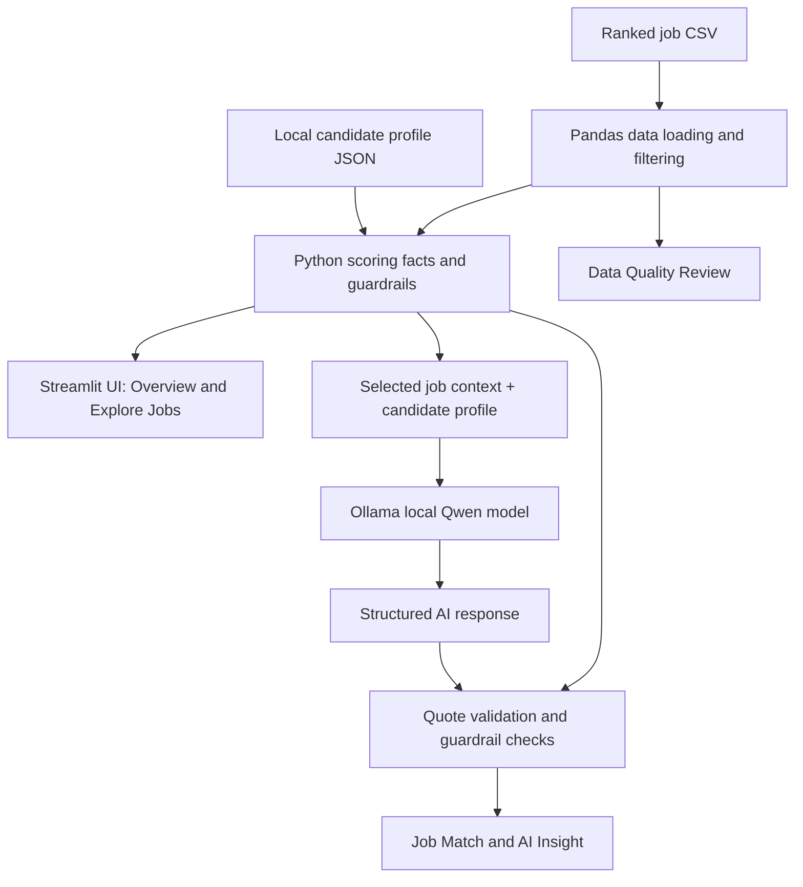

# AI Job Market Copilot

**Explainable job-match screening with local AI career insights**

AI Job Market Copilot is a local-first Streamlit prototype for exploring a ranked dataset of 1,658 job postings, reviewing rule-based fit signals, understanding data uncertainty, and generating contextual career guidance with a locally running Qwen model through Ollama.

> **Core design principle:** Python owns the screening facts and official stored score. The LLM adds contextual explanation; it does not rewrite the score or independently verify candidate proficiency.

## What the app does

- **Explore jobs:** search job titles and use selected keyword synonyms, then review available job records and filters.
- **Inspect fit signals:** view the stored rule-based fit score, data coverage, experience-fit estimate, matched-skill signals, and potential development areas.
- **Generate local AI insights:** connect recorded skills to responsibilities in the stored job description, show validated description excerpts, suggest practice actions, provide CV/portfolio guidance, and generate hypothetical interview questions.
- **Review data quality:** surface incomplete or uncertain fields rather than silently treating every record as complete.
- **Keep AI separate from scoring:** deterministic Python logic keeps key unknowns and the official fit score separate from the LLM's narrative.

## Tech stack

- Python
- Pandas
- Streamlit
- Ollama with `qwen3:4b` (default model in the app)
- CSV ranked-job dataset and local JSON candidate profile

## Architecture



## Run locally on Windows

The app expects the ranked dataset and candidate profile to exist locally. Keep the local profile private.

1. Open PowerShell in the project root—the folder containing `app_ai_v6.py`.
2. Make sure your Python environment has the dependencies already used by the working project, including `pandas` and `streamlit`.
3. Start Ollama and ensure the configured model is installed. For the default model, run `ollama pull qwen3:4b` only if it is not installed already.
4. Start the app:

   ```powershell
   python -m streamlit run app_ai_v6.py
   ```

5. Open the local address printed by Streamlit, usually `http://localhost:8501`.

The default Ollama endpoint is `http://localhost:11434`. If the project already runs in a dedicated Python environment, keep using that environment rather than reinstalling packages unnecessarily.

## Interpreting the results

- **Rule-Based Fit Score:** a score stored by the upstream ranking pipeline. It is not a probability of getting hired and is not modified by the LLM.
- **Data Coverage:** the share of configured scoring weight that can be evaluated from the available fields. High coverage does not guarantee that the source description is complete or authoritative.
- **Experience Fit:** a heuristic signal. A title/level estimate is not the same as an employer-confirmed minimum-experience requirement.
- **Matched skills:** recorded signals from the scoring pipeline, not independent tests of proficiency.
- **Potential skill gaps / skills to develop:** areas flagged for review, not proof that a candidate lacks them.
- **Education fit:** may remain unavailable when the job's explicit education requirement cannot be reliably compared with the candidate profile.
- **AI Insight:** contextual assistance, not a hiring decision. Review suggestions and verify requirements before acting on them.

## Validation performed

The local application was reviewed using two representative job examples:

- **Business Analyst — Purplle:** the analysis connected recorded SQL and Power BI skills to the stored description's data retrieval, dashboard, and KPI responsibilities. It kept e-commerce/logistics domain experience as unverified.
- **Senior Data Analyst — Introhive:** the analysis connected recorded SQL, Python, and visualization skills to end-to-end analysis, reusable templates, dashboards, and data quality responsibilities. The five-year estimate was explicitly described as a title/level heuristic, not a confirmed employer requirement.

These are representative checks, not exhaustive validation of all 1,658 postings or every possible LLM response. The local AI may still produce inaccurate or generic content.

## Known limitations

- Search uses title/keyword matching and selected synonyms; it is **not embedding-based semantic search**.
- Some experience estimates are inferred from title/level heuristics when explicit numeric requirements are unavailable.
- Education requirements and other fields may be missing or unstructured.
- Matched-skill and development flags are ranking signals, not validated proficiency assessments.
- LLM-generated content can still be wrong or overgeneralize; validated snippets and guardrails reduce risk but do not guarantee correctness.
- Original posting URLs are outside the V1 scope.
- Dataset provenance, license, and redistribution rights must be verified before raw data is shared publicly.

## Privacy and publication

Do not commit `candidate_profile.json` if it contains personal information. Do not include raw ranked job data in a public repository unless its license and redistribution permissions are confirmed. If data rights are unclear, publish code and documentation separately and use a small synthetic sample only if the app can support one.

## Suggested portfolio summary

> Built a local-first career intelligence prototype with Streamlit, Pandas, and Ollama. It explores 1,658 ranked job postings, presents rule-based fit signals and data coverage, and generates contextual career guidance with a local Qwen model—while keeping AI-generated advice separate from the official score and surfacing uncertainty in job requirements.
